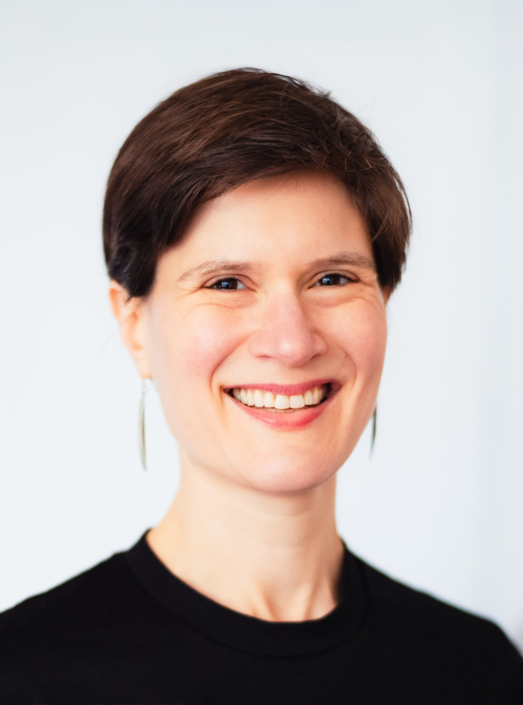

{.profile-pic fig-alt="Headshot of Ella Kaye, a woman of around 40 with short brown hair looking slightly off-camera and smiling" fig-align="center" width="33%"}

I am a Senior Research Software Engineer in the [Department of Advanced Research Computing](https://www.birmingham.ac.uk/research/arc){target="_blank"} at the University of Birmingham. I am also a Fellow of the [Software Sustainability Institute](https://software.ac.uk){target="_blank"} (2025 cohort).

My main professional project is as a co-lead on the RSMF-funded project "[Enabling the Next Generation of Contributors to R](https://blog.r-project.org/2025/12/17/rsmf-enabling-the-next-generation-of-contributors-to-r/index.html)", 
working primarily with [Dr Heather Turner](https://heatherturner.net){target="_blank"}. I previously worked with Heather on her [fellowship](https://society-rse.org/community/rse-fellows/){target="_blank"} "Sustainability and EDI (Equality, Diversity and Inclusion) in The R Project". Together, these projects support The R Project through:

👩‍💻 Contributing code, infrastructure & outreach

📦 Contributing to packages on the Comprehensive R Archive Network (CRAN)

🚀 Capacity-building in R and data science at the University of Warwick and University of Birmingham

💪 Community-building in the R and RSE communities with a focus on EDI

👥 Establishing a cohort of expert contributors to base R

🖐️ Supporting broader engagement for both new and experienced contributors to base R

💬 Improving communication between the R Core Team and the wider R community

💰 Sustaining the R Foundation, the non-profit behind R

<!-- Please see my [professional webpage](https://warwick.ac.uk/EllaKaye){target="_blank"} for more details, including links to my teaching resources.-->

### Previously

It's not unusual for Research Software Engineers to have wiggly career paths, and mine is no exception.

Prior to becoming a Research Software Engineer, my academic path has taken me from a BA in Mathematics and Philosophy (University of Oxford), through an MA in History and Philosophy of Science and Technology (University of Toronto), an MPhil in Mathematics Education (University of Cambridge), an MSc in Applied Statistics (University of Oxford) and the [OxWaSP programme](http://www.oxwasp-cdt.ac.uk){target="_blank"} for postgraduate research in Statistics (University of Warwick). I also have a PGCE in Secondary Mathematics, have taught at secondary school, and worked in market research.

<!-- You can check out my [CV](CV.pdf) for more details. -->

### My  journey

- 2014: first R course as part of MSc in Applied Statistics

- 2015: first taste of `ggplot2`

- 2016: first [R package](packages/BradleyTerryScalable/index.qmd){target="_blank"}

- 2017: first community involvement (useR!2017, [Oxford R User Group](https://r-oxford.github.io){target="_blank"}, [rainbowR](https://rainbowr.org){target="_blank"})

- 2020: first [TidyTuesday](https://github.com/rfordatascience/tidytuesday) contribution

- 2021: third time's the charm building a website in R, using [{distill}](https://rstudio.github.io/distill/){target="_blank"}

- 2022: as an RSE, I now get to be both an  enthusiast *and* professional

- 2023: first patch accepted in base R  

I love R! I have used it in extensively in my research as a statistician for visualising, analysing and modelling data. I have also used it for personal projects and writing [packages](packages.qmd). My enthusiasm for all things RMarkdown (especially {distill}) has now morphed into excitement about [Quarto](https://quarto.org){target="_blank"}. I have particularly enjoyed using it to build this website (my fourth!) [^about-1]

[^about-1]: Previous versions were built with blogdown, then hugodown, then distill.

I love the R community! I am a co-founder and chair of [rainbowR](https://rainbowr.org), a community that supports, promotes and connects LGBTQ+ people who code in the R language. I am the [R Forwards](https://forwards.github.io){target="_blank"} community team co-lead. I have previously been co-organiser of the [Warwick R User Group](https://www.meetup.com/Warwick-useRs/) and the [Oxford R User Group](https://www.meetup.com/Oxford-R-User-Group/). Here's more on the [communities](community.qmd) that I'm involved with, as well as lots of information about, and links to, groups that you may be interested in getting involved with.

I enjoy sharing what I know/am learning about R with others, particularly by writing blog [posts](posts.qmd) and speaking at [R-Ladies](https://rladies.org) and [R User Group](https://www.meetup.com/pro/r-user-groups/) meetups. Here are some [talks](talks.qmd) I've given. Please [get in touch](contact.qmd) if you'd like me to speak at your group.

I live in Oxford, UK, with my wife and our two young children.
